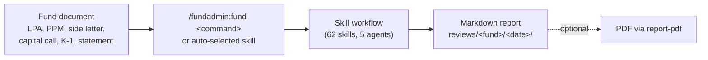
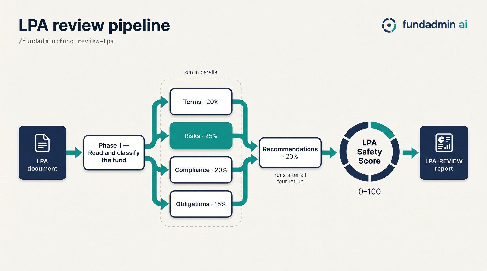
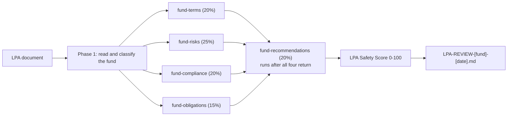
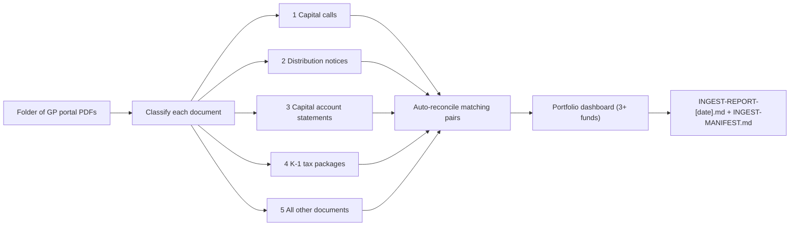
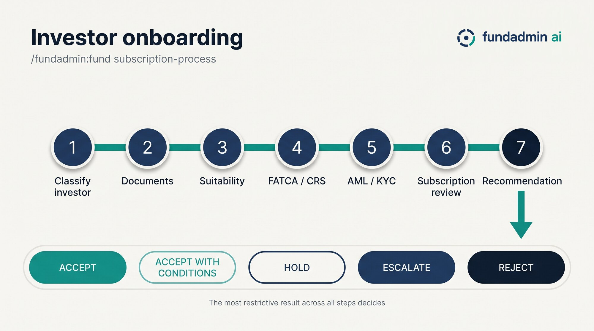
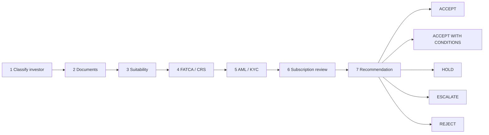

<!-- Generated by tools/build_plugin.py in https://github.com/davendra/fundadmin-ai. Edit the source there, not this file. -->
<p align="center">
  
</p>

<p align="center">
<a href="https://github.com/davendra/fundadmin-ai-skills/releases"></a> <a href="https://github.com/davendra/fundadmin-ai-skills/blob/main/LICENSE"></a> <a href="#all-62-commands"></a> <a href="#the-5-agents"></a> <a href="https://github.com/davendra/fundadmin-ai-skills/actions/workflows/validate.yml"></a>
<br>
<a href="#claude-code"></a> <a href="#claude-cowork"></a> <a href="#codex"></a>  <a href="AGENTS.md"></a>
</p>

<p align="center">
  <a href="https://help.fundadmin.dev"><b>Manual</b></a> ·
  <a href="#install">Install</a> ·
  <a href="#quick-start">Quick start</a> ·
  <a href="#how-it-works">How it works</a> ·
  <a href="#all-62-commands">Commands</a> ·
  <a href="#the-5-agents">Agents</a> ·
  <a href="#for-ai-agents">For AI agents</a> ·
  <a href="#faq-and-troubleshooting">FAQ</a>
</p>

# FundAdmin AI

**62 fund administration skills for Claude Code, Cowork and Codex: review LPAs, PPMs, side letters, capital calls, distributions, K-1s and capital account statements; draft notices and investor letters; run compliance, KYC/AML and FATCA/CRS checks; track obligations and MFN elections; model performance and cash flows; and produce PDF reports.**

It installs as one plugin, `fundadmin`, and runs entirely inside your AI host: no server, no database, no API key. Point it at the documents you already have and it writes a structured markdown report next to them.

> [!IMPORTANT]
> FundAdmin AI produces document analysis and drafts to support fund administration work. It is **not financial, legal or tax advice**. Every report says so. Have qualified professionals review anything you rely on.

## Install

### Claude Code

```bash
claude plugin marketplace add davendra/fundadmin-ai-skills
claude plugin install fundadmin@fundadmin-ai-skills
```

Or inside a session: `/plugin marketplace add davendra/fundadmin-ai-skills`, then `/plugin install fundadmin@fundadmin-ai-skills`. Restart the session once to load it.

### Claude Cowork

**Customize → Plugins → Add marketplace**, enter `davendra/fundadmin-ai-skills`, then install **FundAdmin AI**.

### Codex

```bash
codex plugin marketplace add davendra/fundadmin-ai-skills
codex plugin add fundadmin@fundadmin-ai-skills
```

### Plain skills, no plugin system

```bash
curl -fsSL https://raw.githubusercontent.com/davendra/fundadmin-ai/main/install.sh | bash
```

Installs the same skills into `~/.claude/skills/` from the [source repository](https://github.com/davendra/fundadmin-ai). Commands are then `/fund <command>` without the plugin prefix.

**Optional:** `pip3 install reportlab` turns any review into a branded PDF with `report-pdf`. Nothing else needs a dependency.

## Quick start

This repository ships [`samples/`](samples/README.md): 24 synthetic documents for one fictional fund family, most with planted issues for the skills to find and two clean controls that should pass.

```bash
git clone https://github.com/davendra/fundadmin-ai-skills.git && cd fundadmin-ai-skills
```

Then, in Claude Code or Cowork:

```text
/fundadmin:fund                                                    # the menu
/fundadmin:fund review-lpa samples/OBRELUND-LPA-QUICKSTART.pdf      # 10 planted issues, scored 0-100
/fundadmin:fund review-capital-call samples/OBRELUND-CAPITAL-CALL-1.pdf
/fundadmin:fund wire-verify samples/email-wire-change-suspicious.md
```

In Codex, name the skill instead: `$fund-review-lpa samples/OBRELUND-LPA-QUICKSTART.pdf`. In any host you can also just share a document and say what you need; the matching skill is picked from its description.

## How it works

<p align="center"></p>

<details>
<summary>Text version (screen readers and AI agents)</summary>

A fund document goes in. The `/fund` menu, or the host's own skill matching, hands it to one of 62 skills. The skill follows a written workflow, launching specialist agents where it needs them, and writes a markdown report. `report-pdf` can turn any report into a PDF.



</details>

Most skills write into one dated tree per fund, so later skills can build on earlier output. Each skill's description names its exact output file.

```text
reviews/
└── <fund-slug>/
    └── <YYYY-MM-DD>/
        ├── reports/      LPA-REVIEW-…, COUNSEL-HANDOFF-…, PPM-REVIEW-…
        ├── analysis/     BENCHMARK-REPORT-…, WATERFALL-REVIEW-…, TERMS-EXTRACT-…
        ├── drafts/       CAPITAL-CALL-…, DISTRIBUTION-NOTICE-…, INVESTOR-LETTER-…
        ├── compliance/   COMPLIANCE-REVIEW-…, KYC-REVIEW-…, FILING-PREP-…
        ├── tracking/     MFN-TRACKER-…, OBLIGATION-TRACKER-…, COVENANT-MONITOR-…
        ├── analytics/    PERFORMANCE-REPORT-…, CASHFLOW-FORECAST-…, SCENARIO-MODEL-…
        └── portfolio/    PORTFOLIO-DASHBOARD-…, RECONCILIATION-…
```

### The flagship: LPA review

<p align="center"></p>

<details>
<summary>Text version (screen readers and AI agents)</summary>

`review-lpa` reads the LPA and classifies the fund. Four agents (terms, risks, compliance, obligations) then run in parallel. The recommendations agent runs after all four return, because it builds on their findings. The five results are weighted into the LPA Safety Score, and the report is written once, complete.



</details>

| Agent | Dimension | Weight |
|---|---|---|
| `fundadmin:fund-terms` | Terms & Provisions | 20% |
| `fundadmin:fund-risks` | Risk Assessment | 25% |
| `fundadmin:fund-compliance` | Regulatory Compliance | 20% |
| `fundadmin:fund-obligations` | Obligations & Timeline | 15% |
| `fundadmin:fund-recommendations` | Recommendations | 20% |

| Score | Grade | Label |
|---|---|---|
| 90-100 | **A+** | LP-Favorable |
| 80-89 | **A** | Balanced |
| 70-79 | **B** | Acceptable |
| 60-69 | **C** | Caution |
| 40-59 | **D** | GP-Heavy |
| 0-39 | **F** | Aggressive |

A full review of a long LPA runs five agents and typically takes 15 to 40 minutes.

### Batch intake

<p align="center"></p>

<details>
<summary>Text version (screen readers and AI agents)</summary>

`ingest` takes a folder of mixed PDFs downloaded from GP portals. It classifies each file by content, reviews them in priority order (capital calls first, because they carry payment deadlines), up to three at a time, reconciles matching pairs such as a capital call and the next statement, and builds a portfolio dashboard when three or more funds are present.



</details>

### Investor onboarding

<p align="center"></p>

<details>
<summary>Text version (screen readers and AI agents)</summary>

`subscription-process` runs seven steps in order and returns one of five recommendations. The most restrictive result across all steps decides, so a single hard fail, such as a sanctions match, cannot be averaged away.



</details>

## All 62 commands

<p align="center"></p>

Type the command as shown, or call a skill directly: `/fundadmin:fund-review-lpa <file>`. Codex users name the skill: `$fund-review-lpa`.

### Document Review · 12

| Command | What it does |
|---|---|
| `/fundadmin:fund review-lpa <file>` | Full LPA review (5 parallel agents) |
| `/fundadmin:fund review-ppm <file>` | PPM/offering document review |
| `/fundadmin:fund review-subscription <file>` | Subscription agreement review |
| `/fundadmin:fund review-side-letter <file>` | Side letter obligation extraction |
| `/fundadmin:fund review-capital-call <file>` | Capital call notice validation & scoring |
| `/fundadmin:fund review-distribution-notice <file>` | Distribution notice validation & tax checks |
| `/fundadmin:fund review-capital-account <file>` | Capital account statement review & math check |
| `/fundadmin:fund review-k1 <file>` | Schedule K-1 (Form 1065) review & UBTI/ECI flags |
| `/fundadmin:fund review-poa <file>` | Power of attorney review & risk assessment |
| `/fundadmin:fund review-gp-update <file>` | GP quarterly activity update analysis |
| `/fundadmin:fund compare <file1> <file2>` | Side-by-side document comparison |
| `/fundadmin:fund extract-terms <file>` | Key terms & definitions extraction |
### Document Generation · 4

| Command | What it does |
|---|---|
| `/fundadmin:fund draft-capital-call <data>` | Generate capital call notice (ILPA-compliant) |
| `/fundadmin:fund draft-distribution <data>` | Generate distribution notice with waterfall |
| `/fundadmin:fund draft-investor-letter <type>` | Generate investor communications |
| `/fundadmin:fund draft-side-letter <terms>` | Generate side letter from provisions |
### Compliance & Regulatory · 3

| Command | What it does |
|---|---|
| `/fundadmin:fund check-compliance <file>` | Compliance gap analysis (FATCA/CRS/AML/ERISA) |
| `/fundadmin:fund kyc-review <file>` | KYC/AML document completeness review |
| `/fundadmin:fund regulatory-filing <type>` | Regulatory filing preparation (Form PF/D/ADV) |
### Analysis & Reporting · 3

| Command | What it does |
|---|---|
| `/fundadmin:fund audit-support <file>` | Audit confirmation & schedule generation |
| `/fundadmin:fund waterfall-review <file>` | Waterfall/fee calculation term review |
| `/fundadmin:fund report-pdf` | Professional PDF report with score gauge and risk dashboard |
### Negotiation & Strategy · 6

| Command | What it does |
|---|---|
| `/fundadmin:fund lpa-negotiate <file>` | LPA negotiation strategy & redline suggestions |
| `/fundadmin:fund benchmark <file>` | Terms benchmarking against market standards |
| `/fundadmin:fund plain-english <file>` | Plain English translation of fund documents |
| `/fundadmin:fund playbook <files>` | Terms playbook from multiple fund documents |
| `/fundadmin:fund search-precedent <query>` | Search prior reviews for similar provisions & negotiation precedent |
| `/fundadmin:fund counsel-handoff <review>` | Package review analysis for external legal counsel |
### Tracking & Monitoring · 4

| Command | What it does |
|---|---|
| `/fundadmin:fund mfn-tracker <files>` | MFN election tracking across side letters |
| `/fundadmin:fund obligation-tracker <files>` | Obligation compliance tracking & deadlines |
| `/fundadmin:fund covenant-monitor <file>` | Debt covenant monitoring & breach alerts |
| `/fundadmin:fund regulatory-calendar <details>` | Regulatory filing calendar generation |
### Analytics & Modeling · 4

| Command | What it does |
|---|---|
| `/fundadmin:fund performance-calc <data>` | Performance metrics (IRR, TVPI, DPI, RVPI) |
| `/fundadmin:fund cashflow-forecast <data>` | Cash flow forecasting & liquidity planning |
| `/fundadmin:fund scenario-model <data>` | Scenario modeling & sensitivity analysis |
| `/fundadmin:fund fee-audit <file>` | Fee calculation audit & verification |
### Investor & Operations · 4

| Command | What it does |
|---|---|
| `/fundadmin:fund investor-onboard <type>` | Investor onboarding checklist & workflow |
| `/fundadmin:fund ddq-respond <file>` | DDQ/RFP response drafting from templates |
| `/fundadmin:fund entity-map <file>` | Fund structure & entity relationship mapping |
| `/fundadmin:fund data-room <type>` | Virtual data room organizer & checklist |
### Portfolio Intelligence · 3

| Command | What it does |
|---|---|
| `/fundadmin:fund portfolio-dashboard <files>` | Multi-fund portfolio aggregation & analytics |
| `/fundadmin:fund reconcile <file1> <file2>` | Cross-document reconciliation & discrepancy detection |
| `/fundadmin:fund review-deed <file>` | Deed of adherence / equity wrapper review |
### Investor Compliance & Onboarding · 6

| Command | What it does |
|---|---|
| `/fundadmin:fund investor-classify <file>` | Auto-classify investor type & determine document requirements |
| `/fundadmin:fund fatca-crs-classify <file>` | FATCA/CRS tax classification & required forms determination |
| `/fundadmin:fund suitability-check <file>` | Qualified Purchaser / Accredited Investor / Qualified Client check |
| `/fundadmin:fund aml-screen <file>` | AML screening — PEP, sanctions, source of funds, risk rating |
| `/fundadmin:fund kyc-tracker <files>` | Multi-investor KYC document collection tracker & refresh alerts |
| `/fundadmin:fund subscription-process <file>` | End-to-end subscription pipeline — classify to acceptance |
### Document Intake · 2

| Command | What it does |
|---|---|
| `/fundadmin:fund ingest <folder>` | Auto-classify & batch process folder of mixed fund documents |
| `/fundadmin:fund ingest-email <file>` | Parse email + attachments, cross-validate, extract action items |
### Knowledge Management · 3

| Command | What it does |
|---|---|
| `/fundadmin:fund vault-init [path]` | Create Obsidian vault with dashboards, templates & Dataview queries |
| `/fundadmin:fund vault-sync [path]` | Sync reviews into vault with frontmatter, tags & backlinks |
| `/fundadmin:fund monitor-email [--days N]` | Monitor Gmail for GP emails with PDF attachments, download to vault Inbox |
### Advanced · 4

| Command | What it does |
|---|---|
| `/fundadmin:fund multi-doc-analyze <files>` | Multi-document cross-reference analysis |
| `/fundadmin:fund smart-contract-sim <file>` | Waterfall simulation & scenario calculator |
| `/fundadmin:fund chat` | Conversational fund administration query |
| `/fundadmin:fund amendment-draft <file>` | LPA/side letter amendment drafting |
### ESG, Tax & Specialized · 4

| Command | What it does |
|---|---|
| `/fundadmin:fund esg-report <data>` | ESG reporting & SFDR compliance |
| `/fundadmin:fund tax-review <file>` | K-1/tax document review & analysis |
| `/fundadmin:fund board-memo <type>` | Board/LPAC memo & resolution drafting |
| `/fundadmin:fund wire-verify <data>` | Payment anomaly detection & verification |

## The 5 agents

| Agent | Role | Weight | What it does |
|---|---|---|---|
| `fundadmin:fund-terms` | Terms & Provisions | **20%** | Extract and categorize every LPA provision; its output feeds the other four agents |
| `fundadmin:fund-risks` | Risk Assessment | **25%** | Score each provision 1-10 for GP-favorability, LP exposure and deviation from market |
| `fundadmin:fund-compliance` | Regulatory Compliance | **20%** | Check an LPA against SEC, ERISA, FATCA/CRS, AML/KYC, AIFMD and SFDR rules |
| `fundadmin:fund-obligations` | Obligations & Timeline | **15%** | Map every obligation, deadline, notice and cure period into a timeline |
| `fundadmin:fund-recommendations` | Recommendations | **20%** | Turns the other four outputs into ranked negotiation points and language |

On a host without subagents, `review-lpa` runs the same five prompts inline, in the same order.

## Output files

Each skill writes a fixed filename family, so downstream skills (`report-pdf`, `counsel-handoff`, `search-precedent`, `vault-sync`) can find earlier results. The markdown families the menu documents are below; `report-pdf` writes `FUND-REVIEW-REPORT.pdf`, and a few skills (for example `aml-screen`) write their file to the working directory. `catalog.json` lists each skill's output.

| Folder | Filename families |
|---|---|
| `reports/` | `LPA-REVIEW-…`, `COUNSEL-HANDOFF-…`, `PPM-REVIEW-…`, `SUBSCRIPTION-REVIEW-…`, `SIDE-LETTER-REVIEW-…`, `CAPITAL-CALL-REVIEW-…`, `DISTRIBUTION-REVIEW-…`, `CAPITAL-ACCOUNT-REVIEW-…`, `K1-REVIEW-…`, `POA-REVIEW-…`, `GP-UPDATE-REVIEW-…`, `DEED-REVIEW-…` |
| `analysis/` | `BENCHMARK-REPORT-…`, `WATERFALL-REVIEW-…`, `TERMS-EXTRACT-…`, `PLAIN-ENGLISH-…`, `FUND-COMPARISON-…`, `MULTI-DOC-ANALYSIS-…`, `TERMS-PLAYBOOK-…`, `PRECEDENT-SEARCH-…` |
| `drafts/` | `CAPITAL-CALL-…`, `DISTRIBUTION-NOTICE-…`, `INVESTOR-LETTER-…`, `SIDE-LETTER-…`, `AMENDMENT-DRAFT-…` |
| `compliance/` | `COMPLIANCE-REVIEW-…`, `KYC-REVIEW-…`, `FILING-PREP-…`, `REGULATORY-CALENDAR-…` |
| `tracking/` | `MFN-TRACKER-…`, `OBLIGATION-TRACKER-…`, `COVENANT-MONITOR-…` |
| `analytics/` | `PERFORMANCE-REPORT-…`, `CASHFLOW-FORECAST-…`, `SCENARIO-MODEL-…`, `FEE-AUDIT-…` |
| `portfolio/` | `PORTFOLIO-DASHBOARD-…`, `RECONCILIATION-…` |

## For AI agents

This repository is written to be read by agents as well as people:

- **[`AGENTS.md`](AGENTS.md)**: how to install the plugin for a user, choose and invoke a skill, where outputs go, the rules every output follows, and how to validate changes. `CLAUDE.md` imports it.
- **[`catalog.json`](catalog.json)**: every skill and agent with its command in each host, category, trigger description, output family and file path.
- **[`llms.txt`](llms.txt)**: a compact index in the [llms.txt](https://llmstxt.org) format.
- Every diagram above has a **text version** (expand it) with the same flow in Mermaid.

## Requirements and privacy

- **Required:** Claude Code, Claude Cowork or Codex.
- **Optional:** Python 3 and `reportlab` for PDFs; the Gmail connector for `monitor-email`; the Obsidian vault MCP server from the [source repository](https://github.com/davendra/fundadmin-ai) for `vault-init`, `vault-sync` and precedent search across a vault. Every skill works without them and says when it skipped something.
- **Privacy:** the plugin has no hooks, no MCP servers and makes no network calls. Documents go only where your AI host already sends them.

## FAQ and troubleshooting

<details>
<summary><b>"Unknown command" or the skills don't appear</b></summary>

Use the plugin prefix: `/fundadmin:fund`, not `/fund` (that form is for the plain-skills install). Restart the session after installing. `claude plugin details fundadmin@fundadmin-ai-skills` should list 63 skills and 5 agents.
</details>

<details>
<summary><b>The PDF wasn't generated</b></summary>

`report-pdf` needs Python 3 and `reportlab` (`pip3 install reportlab`). Without them it hands you the markdown report and the exact command to run elsewhere.
</details>

<details>
<summary><b>An LPA review is taking a long time</b></summary>

That is expected: five agents read the whole agreement, and a full review usually takes 15 to 40 minutes. Shorter documents are faster.
</details>

<details>
<summary><b>How do I update?</b></summary>

Claude Code: `claude plugin update fundadmin@fundadmin-ai-skills`, then restart. Codex: `codex plugin marketplace upgrade`, then `codex plugin add fundadmin@fundadmin-ai-skills`. Cowork: **Update** on the marketplace.
</details>

<details>
<summary><b>Can I use it on real fund documents?</b></summary>

Yes; that is what it is for. Everything under `samples/` is synthetic and marked as such. Treat every output as a draft for a professional to review.
</details>

## What's in the package

```text
plugins/fundadmin/
├── .claude-plugin/plugin.json   Claude Code and Cowork manifest
├── .codex-plugin/plugin.json    Codex manifest
├── skills/fund/                 menu and router, plus scripts/generate_fund_pdf.py and templates/
├── skills/fund-*/SKILL.md       the 62 skills
├── agents/fund-*.md             the 5 LPA-review agents
├── assets/                      logo and icons
└── evals/                       `claude plugin eval` cases
samples/                         synthetic documents to try it on
manual/                          the user manual, published at https://help.fundadmin.dev
catalog.json · llms.txt · AGENTS.md
```

## Contributing

This repository is generated from [`davendra/fundadmin-ai`](https://github.com/davendra/fundadmin-ai) by `tools/build_plugin.py`. Open issues and pull requests there; changes made here are overwritten on the next release.

## License

MIT. See [LICENSE](LICENSE).
