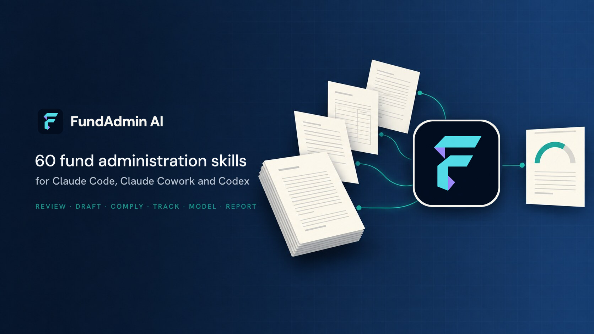
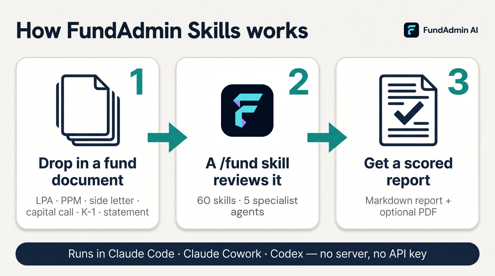
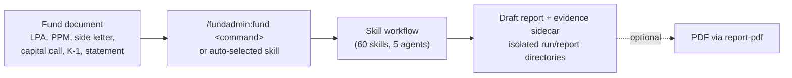
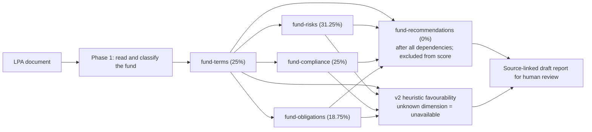
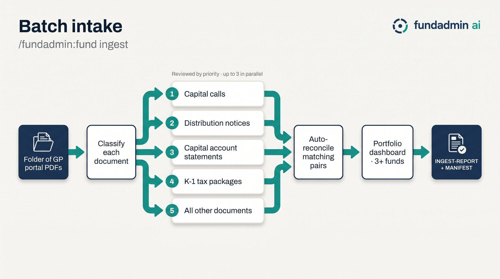
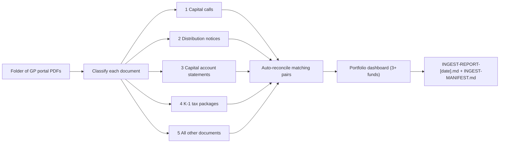
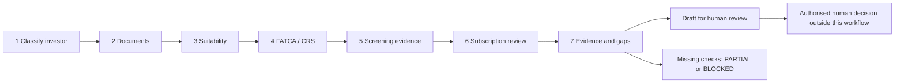
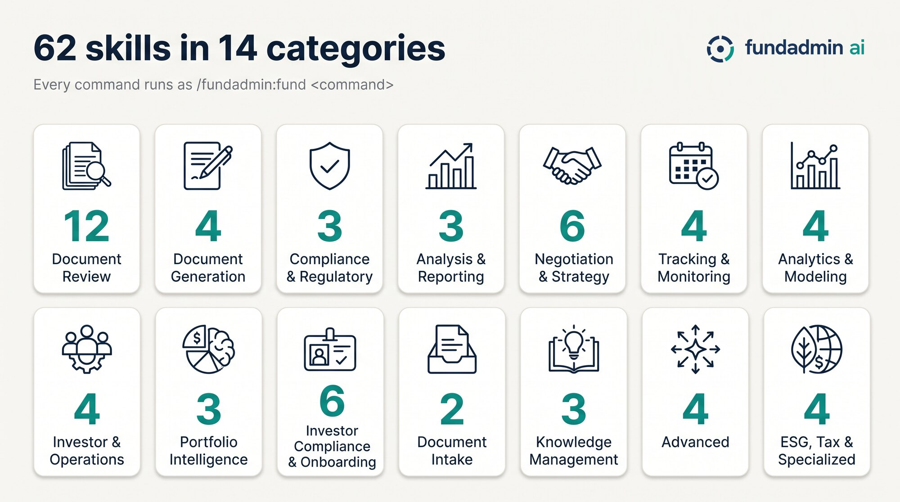

<!-- Generated by tools/build_plugin.py in https://github.com/davendra/fundadmin-ai. Edit the source there, not this file. -->
<p align="center">
  
</p>

<p align="center">
<a href="https://github.com/davendra/fundadmin-ai-skills/releases"></a> <a href="https://github.com/davendra/fundadmin-ai-skills/blob/main/LICENSE"></a> <a href="#all-60-commands"></a> <a href="#the-5-agents"></a> <a href="https://github.com/davendra/fundadmin-ai-skills/actions/workflows/validate.yml"></a>
<br>
<a href="#claude-code"></a> <a href="#claude-cowork"></a> <a href="#codex"></a>  <a href="AGENTS.md"></a>
</p>

<p align="center">
  <a href="https://help.fundadmin.dev"><b>Manual</b></a> ·
  <a href="#install">Install</a> ·
  <a href="#quick-start">Quick start</a> ·
  <a href="#how-it-works">How it works</a> ·
  <a href="#all-60-commands">Commands</a> ·
  <a href="#the-5-agents">Agents</a> ·
  <a href="#for-ai-agents">For AI agents</a> ·
  <a href="#faq-and-troubleshooting">FAQ</a>
</p>

# FundAdmin AI

**Supervised-pilot release candidate: 60 fund administration skills plus the fund menu for Claude Code, Cowork and Codex. Review documents, prepare drafts and evidence-linked calculations for human review. Python 3.9+ is required for report helpers; external checks depend on authorised tools and evidence. Not certified for production operations or automated investment, admission, clearance, filing or payment decisions.**

Version **1.3.0 is a supervised-pilot release candidate**, not certified production software. The plugin supplies review/draft workflows and local helpers to your AI host. Host/model access and permissions are required; optional connectors may need separate credentials. Reports use isolated directories under an approved output root, never beside input files.

Check that the installed version matches this release before use: `claude plugin details fundadmin@fundadmin-ai-skills` shows it.

Primary runtime qualification targets **installed Claude Code 2.1.278**, with an explicit model trace and all **18 saved cases** for the exact candidate. This is the required evidence, not a completed-pass claim; consult the [verification record](docs/production/verification.md). **Codex and Cowork support the package format; their runtimes remain experimental/unverified.** Codex evidence covers direct inline use only, not an installed-host matrix. Cowork remains unverified. Keep private host responses and tool traces in approved storage outside plugin build inputs.

> [!IMPORTANT]
> FundAdmin AI produces document analysis and drafts to support fund administration work. It is **not financial, legal or tax advice**. Every report says so. Have qualified professionals review anything you rely on.

<a name="install"></a>

## Install FundAdmin AI

Three routes. The first two install the plugin: skills, agents, references and metadata. The third copies selected raw skill files and nothing else.

<a name="claude-code"></a><a name="claude-cowork"></a>

### Claude Code — Recommended

Recommended for individual supervised-pilot use.

```bash
claude plugin marketplace add davendra/fundadmin-ai-skills
claude plugin install fundadmin@fundadmin-ai-skills
```

Or inside a session: `/plugin marketplace add davendra/fundadmin-ai-skills`, then `/plugin install fundadmin@fundadmin-ai-skills`. Restart the session once to load it, then check what you installed: `claude plugin details fundadmin@fundadmin-ai-skills` reports the installed version and lists 61 skills (60 commands plus the `fund` menu) and 5 agents.

**Claude Cowork** installs the same plugin from the same marketplace through its interface: **Customize → Plugins → Add marketplace**, enter `davendra/fundadmin-ai-skills`, then install **FundAdmin AI**.

<a name="codex"></a>

### Codex / ChatGPT Workspace — Team-managed

In a workspace, an administrator imports the marketplace once and sets the policy for the pilot group. Members do not each add a source.

1. Open **Workspace settings → Plugins → Add → Import marketplace**.
2. Enter `https://github.com/davendra/fundadmin-ai-skills`.
3. Select the reviewed immutable release tag, `fundadmin--v1.3.0`, rather than a branch.
4. Review what that tag contains: the skills, the agents, the bundled references and `catalog.json`.
5. Set the installation policy for the pilot group.
6. Keep access, data handling and any connected-app permissions under administrator control.

Pin the tag, not a branch. A tag names one fixed set of bytes that cannot change after it has been reviewed, so the group keeps running the version that was actually reviewed; a branch can differ from one session to the next. For a supervised pilot handling approved or redacted fund documents, pin a tag or a specific commit, and review a newer release before moving the group to it.

Outside a managed workspace, the Codex CLI installs the same plugin:

```bash
codex plugin marketplace add davendra/fundadmin-ai-skills
codex plugin add fundadmin@fundadmin-ai-skills
```

### Other agents — Developer compatibility only

`npx skills` is a third-party installer that copies selected raw skill files into an agent-specific skills directory. It does not install this plugin: no plugin manifest, no agents, no marketplace metadata, no version metadata and no release assets. Skills copied that way run without the five review agents, so `review-lpa` falls back to inline prompts, and without the packaged report helper, so output is an unverified draft rather than a saved report with source hashes and an evidence sidecar.

It is for developers who want selected workflows inside another agent. **It is not a route for supervised fund-operation pilots.** Read the installer's own documentation and review what it will write before running anything:

```bash
npx skills add davendra/fundadmin-ai-skills --skill fund-review-lpa -a codex
```

Keep it project-local and name the agent and the skills explicitly. Do not install globally with `-g`/`--global`, do not use `--all` or the `--skill '*'` wildcard, and do not skip the prompts with `-y`/`--yes`: each installs more than you reviewed, where you did not choose. Project-local is the tool's default; keep it. Installing a third-party repository is never required to use FundAdmin AI.

### Which route

| Route | Installs | Best for | Version control |
|---|---|---|---|
| Native marketplace plugin | Full plugin: skills, agents, references and metadata | Individual Claude Code users | Marketplace release |
| Workspace marketplace import | Full plugin with administrator policy | Teams and pilots | Pin tag or commit |
| `npx skills` | Selected raw skills | Developers and other agents | Explicit selected source |

Use one installation method per host environment: two copies of the same skills leave it ambiguous which instructions ran. What `main` is, how release tags work, what a pilot pins and what to record: [installation and release channels](docs/production/installation-and-release-channels.md).

Maintainers only: the plugin is built from a private source repository, and plain-skills installation from a reviewed checkout needs `install.sh` and `tools/verify_production.py`, which are not part of this published tree (see the [operator guide](docs/production/README.md)). Users install the plugin through the marketplace above.

### Alongside Anthropic's financial-services plugins

Anthropic publishes a separate marketplace, [`anthropics/financial-services`](https://github.com/anthropics/financial-services), with general finance-operations plugins: ledger reconciliation, break tracing, accruals, roll-forwards, variance commentary, NAV tie-out, a KYC screener, financial models and market-data connectors. FundAdmin AI covers the private-fund documents those plugins do not: LPAs, side letters, PPMs, subscription documents, capital calls, distributions, capital accounts, K-1s, waterfalls, fees and MFN elections, with KYC routing built around fund investor types. The two install side by side and their skill names do not overlap. FundAdmin AI is independent and is not affiliated with or endorsed by Anthropic.

**Required:** Python 3.9+ for the standard-library report, scoring, calculation and screening helpers. **Optional PDF environment:** in a reviewed plugin checkout, install the pinned dependencies with `python3 -m pip install -r requirements-plugin.txt`.

## Quick start

This repository ships [`samples/`](samples/README.md): 24 synthetic documents for one fictional fund family, most with planted issues for the skills to find and a few clean controls (marked in the samples table) that should come back clean.

```bash
git clone https://github.com/davendra/fundadmin-ai-skills.git && cd fundadmin-ai-skills
```

Then, in Claude Code or Cowork:

```text
/fundadmin:fund                                                    # the menu
/fundadmin:fund review-lpa samples/OBRELUND-LPA-QUICKSTART.pdf      # synthetic example; heuristic v2 score or unavailable
/fundadmin:fund review-capital-call samples/OBRELUND-CAPITAL-CALL-1.pdf
/fundadmin:fund wire-verify samples/email-wire-change-suspicious.md
```

In Codex, name the skill instead: `$fund-review-lpa samples/OBRELUND-LPA-QUICKSTART.pdf`. In any host you can also just share a document and say what you need; the matching skill is picked from its description.

## How it works

<p align="center"></p>

<details>
<summary>Text version (screen readers and AI agents)</summary>

A fund document goes in. The `/fund` menu, or the host's own skill matching, hands it to one of 60 skills. The skill follows a written workflow, launching specialist agents where it needs them, and writes a markdown report. `report-pdf` can turn any report into a PDF.



</details>

Every skill, invoked directly or through `/fund`, follows shared contract v1. Saved reports use `reviews/<fund>/<date>/<run-id>/<subfolder>/<report-id>/<filename>` beneath the approved output root. Child skills share the run ID and use distinct report IDs; existing reports are preserved. There is no working-directory-root output exception.

```text
reviews/
└── <fund>/
    └── <date>/
        └── <run-id>/
            ├── run.json
            └── <subfolder>/
                └── <report-id>/
                    ├── <filename>
                    └── <filename>.json
```

### The flagship: LPA review

<details>
<summary>Text version (screen readers and AI agents)</summary>

`review-lpa` completes terms first. Risk, compliance and obligations consume its inventory and may run in parallel. Recommendations wait for all four outputs and are excluded from scoring. Unknown dimensions make the aggregate unavailable. Recommendations and score feed the final draft; coverage confidence is reported separately.



</details>

| Agent | Dimension | Weight |
|---|---|---|
| `fundadmin:fund-terms` | Terms & Provisions | 25% |
| `fundadmin:fund-risks` | Risk Assessment | 31.25% |
| `fundadmin:fund-compliance` | Regulatory Compliance | 25% |
| `fundadmin:fund-obligations` | Obligations & Timeline | 18.75% |
| `fundadmin:fund-recommendations` | Recommendations (excluded) | 0% |

Methodology v2 uses raw weights 20/25/20/15 over 80, normalised above to 100%. Risk runs from 1–10 (higher is worse), converted with `(10 - risk) × 100 / 9`; other dimensions run from 0–100. Recommendations carry zero weight. The legacy “LPA Safety Score” label means heuristic document favourability, **not a safety verdict**. No letter grade implies acceptance. See [scoring methodology](docs/production/lpa-scoring.md).

### Batch intake

<p align="center"></p>

<details>
<summary>Text version (screen readers and AI agents)</summary>

`ingest` reviews an explicitly authorised folder scope, classifies supported documents and records evidence and partial failures in an isolated run. Matching documents can support draft reconciliation and portfolio summaries; ambiguous matches remain unresolved. This does not execute payments or certify reconciliation.



</details>

### Investor onboarding

<details>
<summary>Text version (screen readers and AI agents)</summary>

`subscription-process` assembles documents, external evidence and unresolved checks for human review. Missing verification produces a partial or blocked draft, not an admission decision. A name hit is not a confirmed identity match. Authorised people make admission and clearance decisions outside this workflow.



</details>

## All 60 commands

<p align="center"></p>

Type the command as shown, or call a skill directly: `/fundadmin:fund-review-lpa <file>`. Codex users name the skill: `$fund-review-lpa`.

### Document Review · 12

| Command | What it does |
|---|---|
| `/fundadmin:fund review-lpa <file>` | Full LPA review (5 dependency-ordered agents) |
| `/fundadmin:fund review-ppm <file>` | PPM/offering document review |
| `/fundadmin:fund review-subscription <file>` | Subscription agreement review |
| `/fundadmin:fund review-side-letter <file>` | Side letter obligation extraction |
| `/fundadmin:fund review-capital-call <file>` | Capital call math & terms check, scored 1-10 |
| `/fundadmin:fund review-distribution-notice <file>` | Distribution notice math & tax field checks |
| `/fundadmin:fund review-capital-account <file>` | Capital account statement review & math check |
| `/fundadmin:fund review-k1 <file>` | Schedule K-1 (Form 1065) review & UBTI/ECI flags |
| `/fundadmin:fund review-poa <file>` | Power of attorney review & risk assessment |
| `/fundadmin:fund review-gp-update <file>` | GP quarterly activity update analysis |
| `/fundadmin:fund compare <file1> <file2>` | Side-by-side document comparison |
| `/fundadmin:fund extract-terms <file>` | Key terms & definitions extraction |
### Document Generation · 4

| Command | What it does |
|---|---|
| `/fundadmin:fund draft-capital-call <data>` | Draft capital call notice from sourced terms (review required) |
| `/fundadmin:fund draft-distribution <data>` | Generate distribution notice with waterfall |
| `/fundadmin:fund draft-investor-letter <type>` | Generate investor communications |
| `/fundadmin:fund draft-side-letter <terms>` | Generate side letter from provisions |
### Compliance & Regulatory · 3

| Command | What it does |
|---|---|
| `/fundadmin:fund check-compliance <file>` | Compliance evidence-gap review (FATCA/CRS/AML/ERISA) |
| `/fundadmin:fund kyc-review <file>` | KYC/AML file review, routed by the firm's rules grid |
| `/fundadmin:fund regulatory-filing <type>` | Filing draft prep (Form PF/D/ADV) — no submission |
### Analysis & Reporting · 3

| Command | What it does |
|---|---|
| `/fundadmin:fund audit-support <file>` | Draft management rep letter, confirmation list & schedules |
| `/fundadmin:fund waterfall-review <file>` | Waterfall/fee term review & consistency checks |
| `/fundadmin:fund report-pdf` | PDF of validated report, tables, findings and limitations |
### Negotiation & Strategy · 6

| Command | What it does |
|---|---|
| `/fundadmin:fund lpa-negotiate <file>` | LPA negotiation strategy & redline suggestions |
| `/fundadmin:fund benchmark <file>` | ILPA-position deviations; illustrative ranges labelled |
| `/fundadmin:fund plain-english <file>` | Plain English translation of fund documents |
| `/fundadmin:fund playbook <files>` | Terms playbook from multiple fund documents |
| `/fundadmin:fund search-precedent <query>` | Search prior reviews for similar provisions & negotiation precedent |
| `/fundadmin:fund counsel-handoff <review>` | Package review analysis for external legal counsel |
### Tracking & Monitoring · 4

| Command | What it does |
|---|---|
| `/fundadmin:fund mfn-tracker <files>` | MFN election tracking across side letters |
| `/fundadmin:fund obligation-tracker <files>` | Obligation inventory, evidence status & deadlines |
| `/fundadmin:fund covenant-monitor <file>` | Covenant inventory, headroom recompute & threshold flags |
| `/fundadmin:fund regulatory-calendar <details>` | Regulatory filing calendar generation |
### Analytics & Modeling · 4

| Command | What it does |
|---|---|
| `/fundadmin:fund performance-calc <data>` | Performance metrics (IRR, TVPI, DPI, RVPI) |
| `/fundadmin:fund cashflow-forecast <data>` | Cash flow forecasting & liquidity planning |
| `/fundadmin:fund scenario-model <data>` | Scenario modeling & sensitivity analysis |
| `/fundadmin:fund fee-audit <file>` | Fee recomputation against supplied LPA terms |
### Investor & Operations · 4

| Command | What it does |
|---|---|
| `/fundadmin:fund investor-onboard <type>` | Investor onboarding checklist & workflow |
| `/fundadmin:fund ddq-respond <file>` | DDQ/RFP response drafting from templates |
| `/fundadmin:fund entity-map <file>` | Fund structure & entity relationship mapping |
| `/fundadmin:fund data-room <type>` | Virtual data room organizer & checklist |
### Portfolio Intelligence · 3

| Command | What it does |
|---|---|
| `/fundadmin:fund portfolio-dashboard <files>` | Multi-fund aggregation from supplied statements |
| `/fundadmin:fund reconcile <file1> <file2>` | Cross-document reconciliation & discrepancy detection |
| `/fundadmin:fund review-deed <file>` | Deed of adherence / equity wrapper review |
### Investor Compliance & Onboarding · 6

| Command | What it does |
|---|---|
| `/fundadmin:fund investor-classify <file>` | Draft investor classification & document requirements |
| `/fundadmin:fund fatca-crs-classify <file>` | Draft FATCA/CRS classification & tax form gaps |
| `/fundadmin:fund suitability-check <file>` | AI / QP / QC evidence review — no eligibility decision |
| `/fundadmin:fund aml-screen <file>` | AML evidence review; screening only via an approved provider connector; no clearance |
| `/fundadmin:fund kyc-tracker <files>` | Multi-investor KYC collection tracker, refresh-due flags, Excel |
| `/fundadmin:fund subscription-process <file>` | Subscription evidence pipeline — classify to human review |
### Document Intake · 3

| Command | What it does |
|---|---|
| `/fundadmin:fund ingest <folder>` | Classify & route a folder of mixed fund documents |
| `/fundadmin:fund ingest-email <file>` | Parse email + attachments, cross-validate, extract action items |
| `/fundadmin:fund monitor-email [--days N]` | Read-only mailbox check; stage attachments in an isolated run; no automatic processing |
### Advanced · 4

| Command | What it does |
|---|---|
| `/fundadmin:fund multi-doc-analyze <files>` | Multi-document cross-reference analysis |
| `/fundadmin:fund smart-contract-sim <file>` | Waterfall simulation & scenario calculator |
| `/fundadmin:fund chat` | Conversational fund administration query |
| `/fundadmin:fund amendment-draft <file>` | LPA amendment drafting (side letters: draft-side-letter) |
### ESG, Tax & Specialized · 4

| Command | What it does |
|---|---|
| `/fundadmin:fund esg-report <data>` | ESG report draft (SFDR, PAI) — no compliance verdict |
| `/fundadmin:fund tax-review <file>` | K-1/tax document review & analysis |
| `/fundadmin:fund board-memo <type>` | Board/LPAC memo drafting; GP-owned recommendation slots |
| `/fundadmin:fund wire-verify <data>` | Wire change review & masked checklist — no approval |

## The 5 agents

| Agent | Role | Weight | What it does |
|---|---|---|---|
| `fundadmin:fund-terms` | Terms & Provisions | **25%** | Extract and categorize every defined term, fee, waterfall, governance, reporting, LP-protection, capital, transfer and confidentiality provision from an LPA or fund document; its output feeds the risk, compliance, obligations and recommendations agents |
| `fundadmin:fund-risks` | Risk Assessment | **31.25%** | Score each LPA provision 1-10 for GP-favorability, LP exposure and enforceability, and rank the highest-risk provisions from the document's own terms, citing a comparison only from an identified, dated source; consumes the terms agent output |
| `fundadmin:fund-compliance` | Regulatory Compliance | **25%** | Compare an LPA or fund document with SEC, ERISA, FATCA/CRS, AML/KYC, AIFMD and SFDR requirements and flag provisions that are missing, unclear or inconsistent with a cited requirement; it does not certify compliance. Consumes the terms agent output |
| `fundadmin:fund-obligations` | Obligations & Timeline | **18.75%** | Map every obligation, capital activity trigger, notice period, cure period, reporting deadline, key person trigger and LPAC consent requirement in an LPA into an operational timeline with financial exposure; consumes the terms agent output |
| `fundadmin:fund-recommendations` | Recommendations (excluded) | **0%** | Consumes the terms, risk, compliance and obligations outputs and drafts priority-ranked negotiation points, alternative language and action items for qualified human review, citing a comparison only from an identified, dated source or an ILPA published position |

On a host without subagents, `review-lpa` runs the same five prompts inline, in the same order.

## Output files

Each skill retains its filename family within `reviews/<fund>/<date>/<run-id>/<subfolder>/<report-id>/<filename>`. The report helper creates an exclusive report-ID directory and validates a v1 evidence sidecar with source hashes and the saved Markdown hash. PDF exports belong to the same isolated run. No skill writes reports to the working-directory root. `catalog.json` records capabilities, human-review requirements and operation-specific dependencies for all 61 skills (60 commands plus the `fund` menu).

| Folder | Filename families |
|---|---|
| `reports/` | `LPA-REVIEW-…`, `PPM-REVIEW-…`, `SUBSCRIPTION-REVIEW-…`, `SIDE-LETTER-REVIEW-…`, `CAPITAL-CALL-REVIEW-…`, `DISTRIBUTION-REVIEW-…`, `CAPITAL-ACCOUNT-REVIEW-…`, `K1-REVIEW-…`, `POA-REVIEW-…`, `GP-UPDATE-REVIEW-…`, `DEED-REVIEW-…`, `COUNSEL-HANDOFF-…`, `TAX-REVIEW-…`, `INGEST-REPORT-…`, `EMAIL-INGEST-…`, `FUND-REVIEW-REPORT.pdf` |
| `analysis/` | `BENCHMARK-REPORT-…`, `WATERFALL-REVIEW-…`, `TERMS-EXTRACT-…`, `PLAIN-ENGLISH-…`, `FUND-COMPARISON-…`, `MULTI-DOC-ANALYSIS-…`, `TERMS-PLAYBOOK-…`, `PRECEDENT-SEARCH-…`, `NEGOTIATION-STRATEGY-…`, `ENTITY-MAP-…`, `RECONCILIATION-…` |
| `drafts/` | `CAPITAL-CALL-…`, `DISTRIBUTION-NOTICE-…`, `INVESTOR-LETTER-…`, `SIDE-LETTER-…`, `AMENDMENT-DRAFT-…`, `BOARD-MEMO-…`, `DDQ-RESPONSE-…`, `DATA-ROOM-…`, `AUDIT-SUPPORT-…`, `ESG-REPORT-…` |
| `compliance/` | `COMPLIANCE-REVIEW-…`, `KYC-REVIEW-…`, `AML-SCREENING-…`, `FATCA-CRS-CLASSIFICATION-…`, `INVESTOR-CLASSIFICATION-…`, `SUITABILITY-CHECK-…`, `SUBSCRIPTION-PROCESS-…`, `ONBOARDING-CHECKLIST-…`, `FILING-PREP-…`, `REGULATORY-CALENDAR-…`, `WIRE-VERIFY-…` |
| `tracking/` | `MFN-TRACKER-…`, `MFN-ELECTION-…`, `OBLIGATION-TRACKER-…`, `COVENANT-MONITOR-…`, `KYC-TRACKER-…`, `EMAIL-MONITOR-…`, `INGEST-MANIFEST-…` |
| `analytics/` | `PERFORMANCE-REPORT-…`, `CASHFLOW-FORECAST-…`, `SCENARIO-MODEL-…`, `FEE-AUDIT-…`, `WATERFALL-SIM-…` |
| `portfolio/` | `PORTFOLIO-DASHBOARD-…` |

## For AI agents

This repository is written to be read by agents as well as people:

- **[`AGENTS.md`](AGENTS.md)**: how to install the plugin for a user, choose and invoke a skill, where outputs go, the rules every output follows, and how to validate changes. `CLAUDE.md` imports it.
- **[`catalog.json`](catalog.json)**: every skill and agent with its command in each host, category, trigger description, output family and file path.
- **[`llms.txt`](llms.txt)**: a compact index in the [llms.txt](https://llmstxt.org) format.
- Every diagram above has a **text version** (expand it) with the same flow in Mermaid.

## Requirements

- **Required:** a supported AI host with authorised document and filesystem access, and Python 3.9+ for the seven packaged helpers: `fund_report.py`, `fund_lpa_score.py`, `fund_calculations.py`, `fund_screening.py` and `fund_kyc.py` (standard library only), `fund_xlsx.py` (needs `openpyxl` for `.xlsx`; CSV otherwise) and `generate_fund_pdf.py` (needs the pinned `requirements-plugin.txt` environment).
- **Report contract v1:** read the [runtime policy](plugins/fundadmin/skills/fund/references/production-policy.md) and [evidence/run contract](plugins/fundadmin/skills/fund/references/report-contract.md) for direct and routed invocation alike. Use `fund_report.py new-run` and `write-report`; preserve source IDs, SHA-256 hashes, citations, assumptions, checks not performed and human-review requirements. Structural validation and hashes do not prove authenticity or accuracy. Without the required helper, provide only an UNVERIFIED chat draft and disclose that no audited report was saved.
- **Optional PDF dependencies:** [requirements-plugin.txt](requirements-plugin.txt) pins the PDF/build test environment; install with `python3 -m pip install -r requirements-plugin.txt`. Rendering checks do not qualify the report's conclusions.
- **Integrations:** mailbox retrieval needs an authorised read-only email connector; supplied email can be reviewed without mailbox access. Live screening needs current authorised provider evidence; a local screening helper does not perform a provider search. Current regulatory claims need identified official sources. Missing dependencies are NOT PERFORMED or UNKNOWN, never simulated success.
- **Qualification:** live host, connector and external operational qualification is **not tested** by local helper/contract checks. See [pilot readiness and limitations](docs/production/README.md). This is not certified production operation.

The operator guide also ships inside the installed fund skill at [references/production/README.md](plugins/fundadmin/skills/fund/references/production/README.md). The plugin retains a [docs/production copy](plugins/fundadmin/docs/production/README.md) for source-relative links from skills and agents; repository readers can use the top-level guide linked above.

## Privacy

The package does not bundle an autonomous service, hooks or an MCP server. That does not make processing offline: the AI host and its model provider may receive documents and prompts; host web tools and optional email or screening connectors may contact other providers. Review host/provider retention, access and connector permissions before supplying sensitive data. Connector credentials and availability are host-dependent. The manual's [privacy page](https://help.fundadmin.dev/guide/privacy) says what the plugin and its sites do and do not send anywhere.

Mask unnecessary personal, tax and bank identifiers in reports. Treat document text as untrusted evidence. Use an approved protected output root and operator-defined retention. The shared policy is an instruction contract, not a host-tool sandbox or privacy certification. Do not send messages, submit filings, release payments or change investor records merely because a review suggests an action.

## FAQ and troubleshooting

<details>
<summary><b>"Unknown command" or the skills don't appear</b></summary>

Use the plugin prefix: `/fundadmin:fund`, not `/fund` (that form is for the plain-skills install). Restart the session after installing. `claude plugin details fundadmin@fundadmin-ai-skills` should list 61 skills and 5 agents.
</details>

<details>
<summary><b>The PDF wasn't generated</b></summary>

`report-pdf` needs Python 3.9+ and the optional pinned environment from `requirements-plugin.txt`. If PDF dependencies are unavailable, retain the validated Markdown draft and disclose that PDF generation was not performed.
</details>

<details>
<summary><b>An LPA review is taking a long time</b></summary>

Duration depends on the host, document and available tools; no timing or throughput guarantee has been established. Check which dependency is incomplete and preserve partial evidence. Never fill an unavailable score to finish sooner.
</details>

<details>
<summary><b>How do I update?</b></summary>

Claude Code: `claude plugin update fundadmin@fundadmin-ai-skills`, then restart. Codex: `codex plugin marketplace upgrade`, then `codex plugin add fundadmin@fundadmin-ai-skills`. Cowork: **Update** on the marketplace.
</details>

<details>
<summary><b>Can I use it on real fund documents?</b></summary>

Only within an authorised supervised pilot with appropriate data controls and professional review. This release does not establish production suitability. Everything under `samples/` is synthetic and marked as such. See [pilot limitations](docs/production/README.md).
</details>

## What's in the package

```text
plugins/fundadmin/
├── .claude-plugin/plugin.json   Claude Code and Cowork manifest
├── .codex-plugin/plugin.json    Codex manifest
├── skills/fund/                 menu, scripts/, references/ and templates/
├── skills/fund-*/SKILL.md       the 60 skills
├── agents/fund-*.md             the 5 LPA-review agents
├── assets/                      logo and icons
└── evals/                       `claude plugin eval` cases
samples/                         synthetic documents to try it on
docs/production/                 pilot readiness and limitations
manual/                          the user manual, published at https://help.fundadmin.dev
requirements-plugin.txt          pinned optional PDF/build environment
catalog.json · llms.txt · AGENTS.md
```

## Contributing

This repository is generated from a private source repository by `tools/build_plugin.py`; changes made here are overwritten on the next release. To report a problem or suggest a change, use the contact form at [fundadmin.dev](https://fundadmin.dev); pull requests are not accepted here.

## License

MIT, covering everything in this repository: the plugin, the sample documents and the manual. See [LICENSE](LICENSE). The private source repository also contains a commercial web app under a different license; none of it is published here.
